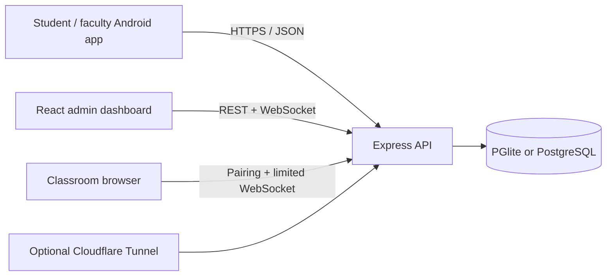

# KAHE Attendance

A college attendance system with a TypeScript API, a React administration dashboard, an Expo Android application, and a browser-based classroom QR display.

Students open a scheduled session, scan its classroom QR, and see their saved attendance status. Faculty can also scan a student's personal pass. Sessions open automatically at their scheduled time. Teachers can confirm an out-of-time QR display or scan; GPS checks are currently disabled.

**Current state:** working development/phone-testing implementation; Android preview version **1.0.2**, version code **3**. This repository includes source, migrations and tests. Local databases, secrets, generated Android projects and APKs are intentionally excluded. A Cloudflare tunnel exposes a running API; the backend is not a Cloudflare Worker, and the admin dashboard is a client of the backend.

See [Current mobile workflow](docs/CURRENT-MOBILE-WORKFLOW.md) for the latest dashboard, timetable, same-day pass and timing rules.

## Documentation

| Document | Read it for |
| --- | --- |
| [Local setup](docs/LOCAL-SETUP.md) | Install dependencies, create demo data, run all three applications, troubleshoot ports |
| [Architecture](docs/ARCHITECTURE.md) | Components, data model, QR contracts, attendance decisions, authorization and location rules |
| [Online deployment](docs/DEPLOYMENT.md) | Temporary Cloudflare access, stable hosting, PostgreSQL, reverse proxy, backups and operational limits |
| [Android builds and testing](docs/ANDROID.md) | Standalone APKs, SDK setup, Windows path workaround, signing, installation and physical-device checks |
| [Work completed](docs/WORK-COMPLETED.md) | Implemented changes, verification and remaining work |
| [Old app and change comparison](docs/OLD-APP-AND-CHANGES.md) | Earlier screens/features, what changed, scope concerns and selective restoration options |
| [Agent instructions](AGENTS.md) | How to safely continue development and validate changes |
| [Contributor workflow](CONTRIBUTING.md) | Human development and review workflow |
| [API guide](docs/API.md) | Main endpoints, authentication and WebSocket messages |
| [Phone testing notes](PHONE-TESTING.md) | The most recent preview testing snapshot; temporary URLs may expire |

## Applications

| Component | Directory | Default local address |
| --- | --- | --- |
| Express API + WebSockets | Repository root, `src/` | `http://localhost:4000` |
| Administration dashboard | `admin-dashboard/` | `http://localhost:5173` |
| Expo mobile web preview | `KAHE-mobile-attendance-frontend-api/` | Use port `8081` explicitly |
| Classroom display | `public/display/`, served by API | `http://localhost:4000/display/` |
| Database | PGlite by default; external PostgreSQL optional | `data/attendance.db/` or `DATABASE_URL` |



## Quick start on Windows PowerShell

Use **Node.js 22.13 or later** with npm. Node 22 LTS is a reasonable baseline for this Expo 57 repository. The three directories have independent lockfiles; install dependencies in each. No npm workspace is configured.

```powershell
git clone https://github.com/PradFr/attendance.git
cd attendance
npm.cmd ci
Copy-Item .env.example .env
npm.cmd run seed
npm.cmd run dev
```

The seed command is for a new disposable demo database. It writes to the configured database; do not run it against existing institutional data. API startup applies numbered migrations automatically but does not create demo users.

In a second terminal:

```powershell
cd attendance/admin-dashboard
npm.cmd ci
npm.cmd run dev
```

In a third terminal:

```powershell
cd attendance/KAHE-mobile-attendance-frontend-api
npm.cmd ci
$env:EXPO_PUBLIC_API_URL='http://localhost:4000/api/v1'
npm.cmd run web -- --port 8081
```

Open the dashboard at `http://localhost:5173` and the mobile preview at `http://localhost:8081`. Check the API at `http://localhost:4000/health`. The web preview is useful for layout and navigation; native camera, GPS and screenshot protection need an Android phone.

On Linux/macOS, first set `export npm_config_script_shell=/bin/sh`: the tracked root `.npmrc` selects PowerShell for the original Windows environment. Then use `npm` instead of `npm.cmd` and `cp .env.example .env`. See the [full platform instructions](docs/LOCAL-SETUP.md).

## Demo sign-in

After seeding a disposable database, these accounts use `password123`:

| Role | Email |
| --- | --- |
| Administrator | `admin@university.edu` |
| Faculty | `prof.alan@university.edu` |
| Faculty | `prof.ada@university.edu` |
| Student | `student.john@university.edu` |
| Student | `student.emily@university.edu` |

Use the admin dashboard for administration and the mobile app for student/faculty flows. Account creation is admin-authenticated. Production requires real accounts and unique secrets; a seeded demo database is not a production installation.

## Attendance workflow

1. Admin configures classes, batches, enrollments and timetable slots.
2. Attendance opens automatically during the scheduled interval in India time.
3. Students open a session to scan its classroom QR or switch to **My QR**. Personal passes are available for today's enrolled sessions, including before/after class.
4. Any teacher assigned to the batch can display its QR or scan student passes. Outside scheduled time, the teacher must confirm a warning to proceed.
5. Successful scans show saved attendance. Pending, rejected and unconfirmed results remain distinct. GPS checks are disabled for now.

## Verification

```powershell
# From repository root: isolated, in-memory backend database
npm.cmd test
npm.cmd run build

cd admin-dashboard
npm.cmd run build

cd ../KAHE-mobile-attendance-frontend-api
npm.cmd test
node node_modules/typescript/bin/tsc --noEmit
```

The backend suite exercises real HTTP and WebSocket authorization as well as policy, replay protection, rollback, classroom pairing, professor location, personal passes and saved status. The mobile suite currently has 28 tests. Database regressions run on PGlite; an external PostgreSQL deployment and real Android devices need their own acceptance checks.

## Internet access and hosting

A standalone APK bundles its own interface. It needs a reachable HTTPS API, not Expo Go or Metro. For a short test, run the API and `cloudflared tunnel --url http://127.0.0.1:4000`. Configure the printed address in the app's **Server connection** field or at build time. Keep the computer and both processes online.

For ongoing use, deploy the Node API with persistent storage or external PostgreSQL, HTTPS and WebSocket support. Serve the built admin dashboard with `/api/v1` and `/ws` routed to the API. See [deployment instructions](docs/DEPLOYMENT.md). No permanent cloud deployment or stable domain is included in this repository.

## Current limits

- Screenshot blocking is native OS protection; browsers cannot enforce it, and another camera can photograph a screen.
- Client GPS and mock-location flags are signals, not hardware attestation. Indoor or approximate location can fail precision checks.
- Biometric comparison and BLE-related policy structures exist; a complete mobile face/liveness/BLE capture workflow is not implemented. The scanner directs those policies to professor verification.
- Display pairing rate limiting and real-time fan-out are process-local. Multiple API replicas require coordinated state and messaging.
- Production hardening remains: restricted CORS, general auth rate limiting, secure account bootstrap, privacy/retention rules, release signing, monitoring, durable backups and external PostgreSQL acceptance testing.

Read [the completed-work and remaining-work record](docs/WORK-COMPLETED.md) before extending or deploying the system.
