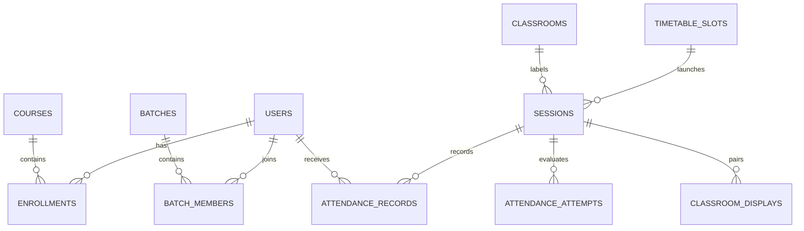
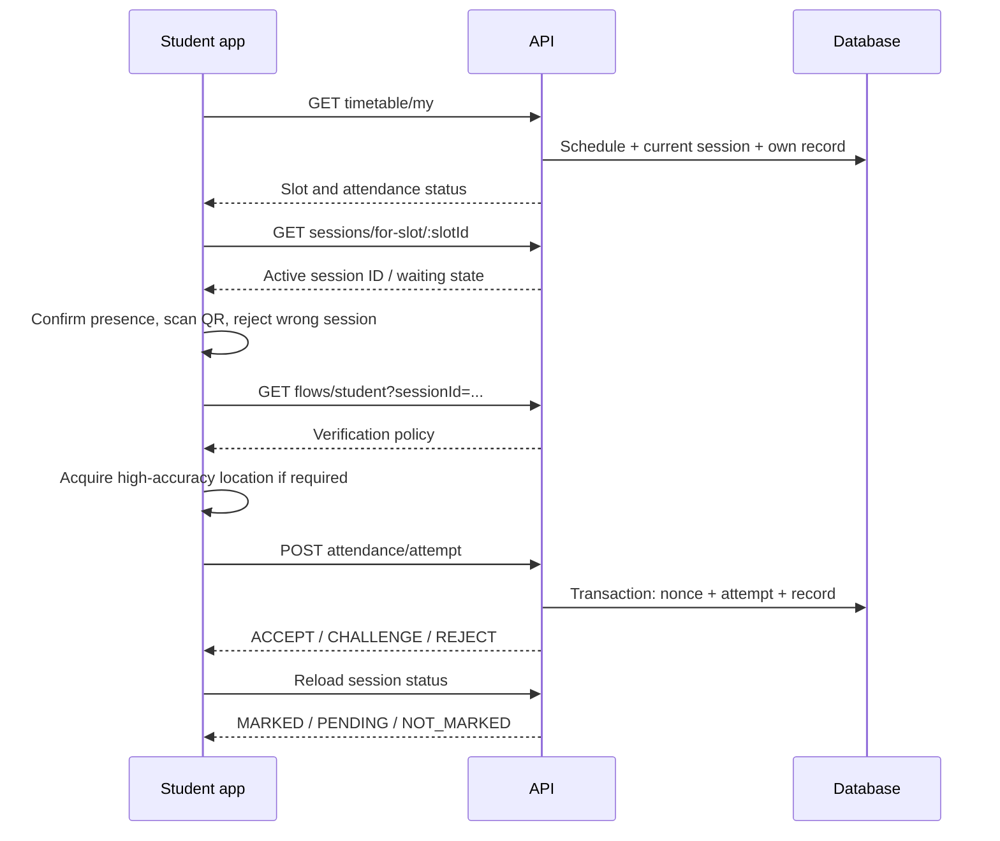

# Architecture and behavior

**Updated workflow:** [Current mobile attendance rules](CURRENT-MOBILE-WORKFLOW.md) supersede the manual-start/GPS descriptions below. Scheduled sessions open automatically; teachers confirm out-of-time actions; students can show same-day passes; GPS checks are paused.

## System boundaries

The repository has one business backend. Express serves JSON routes under `/api/v1`, a health endpoint, browser display assets, an optional APK download and WebSockets at `/ws`. React admin and Expo mobile are independent clients. Neither frontend is the database or the authoritative attendance engine.

Cloudflare Tunnel forwards internet traffic to that Node process. It does not migrate code or data into Cloudflare Workers/D1. If a locally hosted computer, API or tunnel stops, phone access stops. A compiled APK contains the UI but still needs the API to record attendance.

## Backend layering

| Layer | Responsibilities |
| --- | --- |
| `src/server.ts` | Load configuration, run migrations, create HTTP server, initialize sockets, graceful shutdown |
| `src/app.ts` | Middleware, route mounting, static display, optional APK download |
| `routes/` | HTTP paths and role middleware |
| `controllers/` | Request handling, validation, response codes and service calls |
| `services/policy.service.ts` | Student attempt evaluation, persisted records, challenge decisions and professor scans |
| `services/access.service.ts` | Session ownership/enrollment and shared HTTP errors |
| `services/session-context.service.ts` | Resolve timetable slots to current sessions and student's saved status |
| `services/session-location.service.ts` | Validate faculty location and set origin exactly once |
| `services/qr.service.ts` | Signed payloads, expiry, per-student replay checks and QR rendering |
| `services/display.service.ts` | Display pairing, limited credentials, expiry and revocation |
| `services/flow.service.ts` | Policy/capability-driven client instructions |
| `database/db.ts` | PGlite/pg adapter, transaction scope and post-commit notifications |

Services for departments, courses, batches, templates, schedules, announcements, analytics and telemetry support the broader academic administration workflow.

## Data model

- **Users**: role, institutional identity, profile, optional face embedding. JWT identity is checked against the current database role.
- **Courses/enrollments**: course-based attendance membership with active enrollment checks.
- **Batches/members/professors**: cohorts can cross departments/years when configured; staff assignments determine scoped access.
- **Timetable slots**: recurring weekly or specific-date schedule definitions; a slot is not a live session.
- **Sessions**: actual attendance lifetime/status, course or batch target, professor, room, optional policy override, timetable link and optional fixed faculty origin/radius.
- **Attempts**: QR and sensor evidence, diagnostics, decision/reason and timestamps. A rejected attempt is an audit event, not present attendance.
- **Attendance records**: one official record per `(session_id, student_id)`, with current status and marking source.
- **QR nonces**: unique `(nonce, student_id)` consumption permits a shared classroom QR across students.
- **Security violations**: diagnostic/audit events from failed checks; device signals do not establish certainty of misconduct by themselves.
- **Classroom displays**: hashed code/secret, owning session/professor, expiry/revocation state.
- **Materialized views**: analytics summaries; they can lag operational attendance until refreshed.

SQL files 001–011 build this model. `schema_migrations` records filenames, and startup applies only unrecorded migrations. There is no automatic migration downgrade command. A legacy installation with the pre-ledger version-007 schema is adopted without replaying earlier backfills.

## Persistence and consistency

With `DATABASE_URL`, `pg.Pool` obtains a dedicated connection for each transaction. Without it, PGlite runs PostgreSQL in-process with its own transaction API. `AsyncLocalStorage` propagates the active transaction client to nested services. `withTransaction` groups related changes; `afterCommit` broadcasts only once persistence succeeds.

Student attempt evaluation consumes the QR nonce and writes the attempt, violations and official record in that transaction. Failure rolls back those changes. An accepted/present record is protected from a later challenged attempt downgrading it. Challenge resolution validates staff scope, pending state and ownership of the current record.

PGlite is appropriate for one local API owner. It is not shared storage for multiple Node processes/containers. Use external PostgreSQL for a service architecture needing multiple database clients, and add separate cross-replica WebSocket fan-out if scaling the API.

## Session lifecycle and faculty location

`POST /sessions/launch-slot` validates the assigned professor/admin and locks the timetable slot in a transaction. An active unexpired session is reused. Otherwise a new two-hour session is created and linked to the slot. At present launch is not restricted to the slot's weekday/time.

The mobile faculty flow asks for precise foreground location, requests a high-accuracy fix, and submits latitude, longitude, accuracy, timestamp, mocked flag and radius. The server checks finite geographic ranges, accuracy 0–50m, freshness within 60 seconds, radius 25–300m and an affirmative mock-location flag. The UI offers 25m, 50m and 100m; default is 100m.

Origin fields are written only if the session has no origin. Subsequent launches/QR refreshes reuse that origin and radius. The faculty phone can move without relocating the check-in area. For a new location, end the session through the API/admin workflow and start a new session.

Legacy sessions created without a mobile location continue to use classroom coordinates and policy rules. When a mobile-origin session is evaluated, its radius overrides the policy distance and GPS is required. A missing GPS fix goes to professor review rather than being accepted via a legacy subnet shortcut. The classroom name remains the timetable room label even though physical proximity is anchored to the session's starting point.

## Student scanning sequence

The static scanner frame has fixed zoom. A scan locks immediately, vibrates and displays progress. Repeat callbacks stay locked until explicit retry. QR decoding works under Hermes without browser `atob`. Presence is confirmed before submission. GPS and network waits are bounded.

The selected-session scanner compares the QR's embedded session ID with the context's real active session ID. It does not submit another class's QR to the chosen session. If attendance is not open, the screen explains the waiting state and retries context rather than creating a student-owned session.

Only `ACCEPT` is displayed as successful attendance. `CHALLENGE` is pending, `REJECT` explains failure, and a network timeout is unconfirmed because the request may already have reached the server. The session/card status is reloaded from official records: `PRESENT`, `LATE`, `EXCUSED` map to marked; `CHALLENGED` maps to pending; other/no records map to not marked. Timetable context selects the current India-date session or an active unexpired session, avoiding an old week's record being presented as today's attendance.

## Personal student pass / professor scan

**My QR** requests `/attendance/student-qr` for the real session ID. The backend also supports a timetable slot ID by resolving its active session, and returns a clear conflict if attendance has not started. Enrollment, active status and expiry are checked before issuing a 30-second personal pass. The app refreshes every 15 seconds, uses explicit image dimensions, hides expired/failed images and refreshes after foregrounding.

The professor scanner submits the personal payload to `/attendance/professor-scan`. It validates session existence, activity, enrollment and token binding. It records present attendance and emits an after-commit event. An institutional professor outside the assigned class can use the supported audited override path, recorded as `PROFESSOR_OUT_OF_BATCH`; this is an intentional current capability, not unrestricted access to all attendance reads.

This path is an in-person professor verification workflow. It does not automatically assert that student GPS, BLE or biometrics were captured by a reverse scan.

## QR token contract

QR payloads are base64url-encoded JSON, with `SESSION_BROADCAST` or `STUDENT_PERSONAL` type, session ID, nonce, issued/expiry timestamps, signature, optional student ID and exported flag. HMAC-SHA256 binds the signed fields; decoding JSON alone does not verify authenticity. Server verification checks signature, expiry, type and expected identities.

Default live WebSocket tokens rotate every 15 seconds and expire after 20 seconds. Faculty app image exports currently request 60-second validity and refresh every 45 seconds. Personal passes expire after 30 seconds. The export API bounds custom lifetime to 1–900 seconds. These are distinct paths; do not describe every QR as having the same lifetime.

## Browser display pairing

1. Browser opens `/display/` and creates an unclaimed code/device secret.
2. Faculty enter the eight-character code for an active owned session.
3. Atomic claim binds that browser pairing to the session. Unclaimed codes expire after five minutes and are single use.
4. Browser polls state using its device secret, obtains a limited display token and subscribes with `SUBSCRIBE_DISPLAY`.
5. API streams current QR rotations. Browser clears stale codes and reconnects when necessary.
6. Faculty/browser disconnect, session closure or pairing invalidation ends access.

Display tokens use a separate derived signing key/audience and cannot authenticate ordinary account API routes. Display sockets receive QR updates, not student check-in records. Pair creation/claim rate limiting is process-local. Static display responses use a restrictive content policy and no-store/no-referrer headers.

## Authorization and frontend state

HTTP uses bearer JWTs with database-current roles. Administrators manage accounts; public registration is disabled. Students read their own attendance. Professors read assigned sessions according to the shared scope helper, while specific write actions may require the assigned owner. Do not replace route-specific checks with frontend visibility.

Admin tokens are stored in browser localStorage. Mobile authentication is currently component state, so reopening the app requires sign-in; the saved server address persists independently. There is no refresh-token/session-device management system. Admin production token storage and XSS defenses need review before institutional deployment.

Admin WebSocket subscriptions use `SUBSCRIBE` for `CAMPUS` (admin only) or an authorized staff session. Pairing displays use `SUBSCRIBE_DISPLAY` with their limited token. Mobile student status uses authenticated polling: approximately 10 seconds for lists and 5 seconds in a selected session, plus foreground refresh.

## Limits and production implications

GPS, timestamps and mock flags are client-reported. Signature validation proves a server-issued QR, not physical presence by itself. Accuracy is location uncertainty, distinct from Haversine distance. Biometric cosine similarity is not face detection, identity enrollment assurance or liveness. BLE policy scaffolding is not complete mobile BLE capture.

The native capture boundary requests OS screenshot protection before showing content and overlays private data while inactive. Web cannot guarantee screenshot prevention; external cameras and compromised devices remain outside that protection.

CORS currently reflects origins, most routes do not have general rate limiting, the public APK route has no auth and production account bootstrap is manual. These are documented current implementation facts. See [deployment](DEPLOYMENT.md) and [remaining work](WORK-COMPLETED.md) before operating with real student data.
