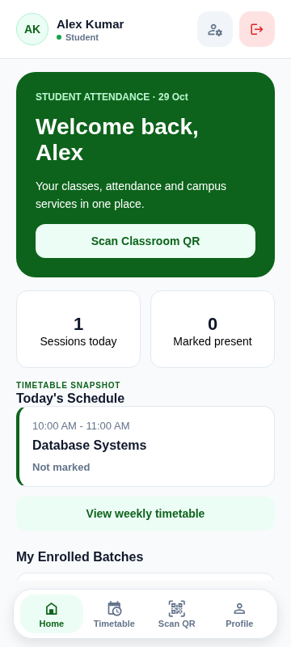
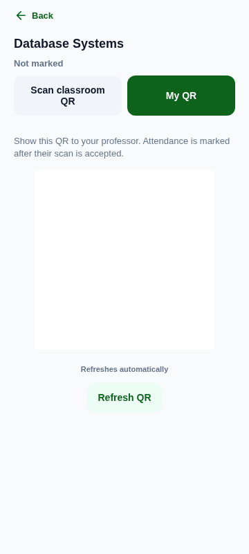
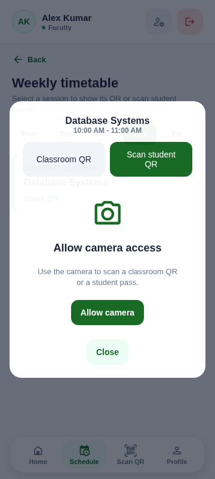

# Mobile UI previews

Browser screenshots of the updated mobile app at a 360px viewport, using isolated mocked demo API data. They do not contain real student records and do not establish native camera or screenshot-protection behavior.

## Student dashboard

## Student personal pass tab

## Teacher scan tab

The teacher session opens on Classroom QR by default; this screenshot shows its secondary Scan student QR tab before camera permission is granted. The fixture QR is an image placeholder, not a working attendance token.
